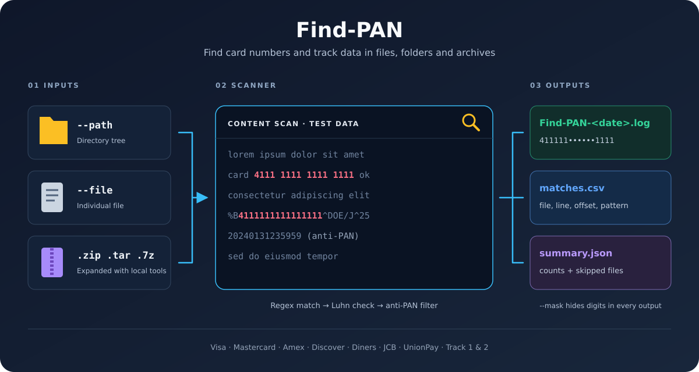

# Find-PAN

Find Primary Account Numbers (PANs) and Track 1 / Track 2 data in files, directory trees, and nested archives. Find-PAN uses configurable regular expressions, anti-PAN filters, and Luhn validation, then writes findings to logs and optional CSV output.



The illustration is a conceptual overview; the detection order and supported text formats are described under [Detection behavior](#detection-behavior).

- [Quick start](#quick-start)
- [Installation](#installation)
- [Usage](#usage)
- [Outputs and exit status](#outputs-and-exit-status)
- [Detection behavior](#detection-behavior)
- [Archives and file handling](#archives-and-file-handling)
- [Raw scans and expected values](#raw-scans-and-expected-values)
- [Configuration](#configuration)
- [Regression baselines](#regression-baselines)
- [Supporting tools](#supporting-tools)
- [Source layout and development](#source-layout-and-development)
- [Data handling](#data-handling)
- [License and author](#license-and-author)

## Quick start

After [installation](#installation), run these commands from the repository root:

```console
uv run python bin/find-pan.py --version
uv run python bin/find-pan.py --file RegressionTests/VISA.txt --mask
uv run python bin/find-pan.py --path /path/to/data --mask --csv matches.csv --summary-json summary.json
```

At least one of `--path` or `--file` is required. You can combine them; explicit files are processed first, followed by the directory tree. Overlapping inputs can be scanned more than once.

The wrapper scripts `bin/find-pan.sh` (Linux, macOS, WSL, Git Bash) and `bin/find-pan.ps1` (PowerShell) run the same program from any directory, in the project environment that `setup-env` created, and pass every argument and the exit status through. They do not change the working directory, so relative paths mean what they say in your shell:

```console
./bin/find-pan.sh --path /path/to/data --mask --summary-json summary.json
.\bin\find-pan.ps1 --path D:\data --mask --summary-json summary.json
```

They use `uv` when it is installed and otherwise the project environment's own Python. Set `UV_PROJECT_ENVIRONMENT` to use a different environment.

Masking is opt-in. Without `--mask`, findings and source lines can contain full PANs and track data.

## Installation

### Requirements

- Python **3.10 or later**.
- [uv](https://docs.astral.sh/uv/) for the project environment, or pip with a virtual environment.
- The platform's **libmagic** library for MIME-based executable detection with `--skip-binary`.
- Local archive extractors for the formats you scan. The shipped configuration includes candidates for `tar`, `unzip`, `7z`/`7zz`/`7za`, and `gzip`; Windows also has candidates for system tar and Git tools. Zip archives fall back to 7-Zip when `unzip` is not installed.

The dependencies are declared in [pyproject.toml](pyproject.toml) and [requirements.txt](requirements.txt). Archive extraction uses external commands rather than Python archive packages.

```console
git clone https://github.com/W1T3H4T/Find-PAN.git
cd Find-PAN
```

### Windows (PowerShell)

With uv installed, run:

```powershell
.\bin\setup-env.ps1 -FileWindows
```

`-FileWindows` adds the `file-windows` dependency to supply `libmagic-1.dll`. If you manage that library yourself, omit the switch and provide the DLL and its `magic1.mgc` database on `PATH` or in `bin/`.

### Linux, WSL, and macOS

Install libmagic, then run the setup script. For Debian/Ubuntu:

```sh
sudo apt update
sudo apt install -y libmagic1 python3-full
./bin/setup-env.sh
```

On macOS with Homebrew, install libmagic with `brew install libmagic` before running the script.

Both setup scripts persist `UV_PROJECT_ENVIRONMENT` for future shells: `.venv-windows` on Windows and `.venv-linux` on POSIX systems, including macOS. This setting affects other uv projects for that user too. The scripts synchronize dependencies, verify pytest, and remove a legacy `.venv` directory if present. Open a new shell afterward. Non-interactive POSIX shells must export the variable themselves.

To install runtime dependencies without the development group:

```console
uv sync --no-dev
```

### pip alternative

Create and activate a virtual environment using [Python's venv instructions](https://docs.python.org/3/library/venv.html), then run:

```console
python -m pip install -r requirements.txt
python bin/find-pan.py --version
```

The native libmagic dependency and archive extractors still need to be supplied separately.

## Usage

```text
uv run python bin/find-pan.py [--path PATH] [--file FILE [FILE ...]]
    [--log-dir LOG_DIR] [--rgx-patterns RGX_PATTERNS] [--rgx-prefix]
    [--skip-binary] [--line-limit LINE_LIMIT] [--report-delta REPORT_DELTA]
    [--csv CSV] [--summary-json PATH] [--raw] [--raw-encodings LIST]
    [--pan-list FILE] [--track-list FILE] [--log-anti-pan]
    [--verbose] [--debug] [--mask] [--version]
```

| Option | Behavior |
| --- | --- |
| `-h`, `--help`            | Show command help and defaults. |
| `--path PATH`             | Recursively scan a directory tree, including recognized archives. |
| `--file FILE [FILE ...]`  | Scan explicit files or archives. Repeat the flag to add more files. Missing files and directories are reported and skipped; use `--path` for directories. |
| `--log-dir DIR`           | Log directory; defaults to `Find-PAN-Logs` in the user's home directory. Created if necessary. |
| `--rgx-patterns FILE`     | Use this regex JSON file instead of searching the standard locations. |
| `--rgx-prefix`            | Prepend the character class `[ '"{]` to every configured PAN expression (anti-PAN and track expressions are left as written). A match must have one of these preceding characters; the prefix becomes part of the match. Default off.<br>*DO NOT utilize* unless you specifically know that it is required for your dataset. |
| `--skip-binary`           | Skip executables and files classified as binary. Archives are still expanded. Default off. |
| `--line-limit N`          | Scan at most N lines per text file. Zero or a negative value scans all lines; default `0`. |
| `--report-delta N`        | Report progress every N scanned files. Must be at least `1`; default `500`. |
| `--csv FILE`              | Write PAN and TRACK findings to a CSV file. Replaces existing contents. |
| `--summary-json FILE`     | Write counts, timings, skipped files, and exit status to JSON. Replaces existing contents. |
| `--raw`                   | Scan every file as raw bytes (memory dumps, disk images): no line splitting, binary skipping or archive expansion. Matches are reported by byte offset. See [Raw scans and expected values](#raw-scans-and-expected-values). Default off. |
| `--raw-encodings LIST`    | With `--raw`: comma-separated text encodings to look for, from `ascii` and `utf-16` (both byte orders). Default `ascii,utf-16`. |
| `--pan-list FILE`         | Report only the PANs listed in FILE (one per line; spaces and hyphens allowed). A report filter on what the configured patterns found, never a source of PANs; the summary lists each value as found (how often, and where first) or not found. Works with or without `--raw`. |
| `--track-list FILE`       | Report only the track 1 or track 2 strings listed in FILE, one per line; works like `--pan-list`. |
| `--log-anti-pan`          | Write anti-PAN hits to their own log and include its path and entry count in the console summary. Default off. |
| `--verbose`               | Also show each PAN and TRACK match on stdout over several lines (type and pattern, then `File`, `Location`, `Pattern` and `Data`, each on its own line, with an empty line between matches), plus extractor commands. The PAN log file keeps its single-line format. |
| `--debug`                 | Enable debug messages on stdout and in the trace log, including failed Luhn candidates and compiled configuration details. |
| `--mask`                  | Keep the first six and last four PAN digits and replace intervening digits with `*`. Track matches have all digits masked; other characters remain. Default off. |
| `--version`               | Print application and Python versions without loading configuration or scanning. |

Scan several files, including archives:

```console
uv run python bin/find-pan.py --file report.txt backup.tar.gz export.zip --mask
```

Choose the log directory and record anti-PAN hits separately:

```console
uv run python bin/find-pan.py --path /path/to/data --log-dir /path/to/logs --mask --log-anti-pan
```

Create parent directories for CSV and JSON destinations before running; only the log directory is created automatically.

## Outputs and exit status

### Logs

Logs use the date format `DDMonYYYY` and append to existing files for that date:

| File | Contents |
| --- | --- |
| `Find-PAN-<date>.log` | PAN and TRACK findings, including file path, 1-based line number, 0-based character offset, pattern, and source line. Also includes scanning messages. |
| `Find-PAN-trace-<date>.log` | Run parameters, progress, extraction messages, skipped files, and final summary. Debug mode adds Luhn failures and other diagnostics. Trace messages also appear on stdout. |
| `Find-PAN-anti-pan-<date>.log` | Anti-PAN findings and source lines; created only with `--log-anti-pan`. These events are excluded from the PAN log and CSV. |

The PAN and trace logs include a run-start marker. The summary reports PANs, TRACKs, Luhn failures, anti-PANs, scanned files, timings, and applicable skip/archive counts. Its skipped-file list is limited to 200 entries; the trace log records every skip.

### CSV and JSON

CSV uses this header:

```csv
filename,line_number,offset,pattern_name,data_type,matched_data
```

`filename` is the base name, not the complete path. `data_type` is `PAN` or `TRACK`. Non-ASCII characters in CSV text fields are replaced with `?`. Line numbers start at 1; offsets start at 0 and count decoded characters, not bytes. With `--raw`, `line_number` is `0` and `offset` is the absolute byte offset in the file.

JSON contains `pans`, `tracks`, `bad_luhn`, `anti_pans`, `files_scanned`, `archives_expanded`, `archives_skipped`, `skipped`, `total_time`, `average_time`, and `exit_status`; with `--pan-list` or `--track-list` also `expected` (see [Raw scans and expected values](#raw-scans-and-expected-values)). Each `skipped` entry is `[reason, path]`; detailed reasons remain in the trace log. Skipped archive members use stable paths such as `backup.zip!/nested/file.txt`, chained for nested archives. Finding logs use extraction paths, and CSV uses base names.

### Exit status

| Status | Meaning |
| --- | --- |
| `0` | Run completed without a fatal error, failed extraction, or invalid explicit file input. Finding PANs does not change the exit status. |
| `1` | Missing scan arguments, configuration/runtime/output error, interruption, missing or non-file `--file` input, or failed/recursive archive extraction. Recoverable file/archive problems allow the remaining inputs to run first. |
| `2` | Command-line parsing error, such as an unknown option or invalid `--report-delta`. |

A zero status does **not** guarantee complete coverage: missing extractors (`ARCHIVE-NO-TOOL`), unreadable files, binary/executable skips, and extracted symbolic links do not independently set a failure status. Check the summary and skipped-file records. A missing or inaccessible `--path` can produce no files without a failure because traversal uses `os.walk` without an error callback.

## Detection behavior

For each decoded line, [detectors.py](src/find_pan/detectors.py):

1. Normalizes delimited PANs: groups of digits joined by one repeated space or hyphen (`4556-7375-8689-9855`), found by the `Delimited PAN Pattern` entries of the regex file, are compacted to plain digits. Only the anti-PAN and PAN expressions see the compacted text; TRACK expressions always see the original line.
2. Finds anti-PAN matches and excludes their character spans. Timestamp matches must also be real calendar dates with a year from 1900 through the current year.
3. Evaluates the remaining configured TRACK and PAN expressions in configuration order. A candidate overlapping an excluded or already accepted span is skipped, so no PAN is taken from accepted track data.
4. Extracts the PAN digits, including the PAN portion of a track record, and applies the Luhn checksum. Valid candidates become findings; invalid candidates are counted as Luhn failures and appear only in debug output.

Findings are reported against the original line: a delimited PAN appears as written, at its original position, with the same pattern name a contiguous PAN would have.

The scanner can report multiple non-overlapping findings per line. An anti-PAN or failed candidate does not suppress unrelated candidates elsewhere on that line. Anti-PAN counts represent anti-pattern matches, not necessarily rejected Luhn-valid PANs.

The shipped [regex configuration](config/find-pan-regex.json) includes American Express, Diners Club Carte Blanche, Diners Club International, Diners Club US and Canada, Discover Card, InstaPayment, JCB, Laser, Maestro, Mastercard, VISA, VISA Electron, and UnionPay, plus Track 1 and Track 2 patterns.

These expressions define the actual coverage. The shipped PAN expressions match contiguous digits; delimited PANs are handled by the normalization step, whose candidate shapes (4-4-4-n, 4-4-4-4-n, 4-6-5 and 4-6-4 groups) are configured in the `Delimited PAN Pattern` section and never decide what is a PAN by themselves. Several expressions use numeric boundaries, but this is not universal. Overlapping issuer ranges are resolved by configured pattern order. Luhn validation does not establish account status or issuer ownership.

The anti-PAN configuration includes timestamps, sequential-number patterns, and repeated-digit groups. Customize these filters carefully because overlapping spans are excluded before PAN/track validation.

## Archives and file handling

`--path`, `--file`, and extracted members share the same file processor in [scanner.py](src/find_pan/scanner.py). It reads the first 1,024 bytes and classifies by content before deciding whether to expand, skip, or scan.

### Archive formats

- Content signatures recognize tar, ZIP, 7z, gzip, bzip2, and xz. Extensions help select tar for compressed tar variants such as `.tar.gz`, `.tgz`, `.tar.bz2`, `.tbz2`, `.tar.xz`, and `.txz`.
- ZIP-based containers, including `.jar`, `.war`, `.ear`, and ZIP-based Office files, can be expanded by the ZIP extractor.
- Standalone bzip2 and xz streams are recognized, but the shipped configuration has no `bzip2` or `xz` extractor entry. Add one to scan these streams.
- A text file named `notes.zip` is scanned as text, with a note about the misleading extension.
- Extracted members go back through the processor, allowing nested archives. SHA-256 digests of active archives prevent an archive from recursively expanding itself. There is no configured archive-depth limit.

Extractors write into a unique system temporary directory, which is removed after processing. If extraction fails after producing files, those members are still scanned and the archive is recorded as `ARCHIVE-FAILED`. Cleanup failures generate a warning.

The extraction watchdog checks these defaults **per extraction**:

| Setting | Default |
| --- | --- |
| `max_extracted_bytes` | 10 GiB |
| `max_files` | 100,000 filesystem entries, including directories |
| `timeout_seconds` | 600 seconds |
| `min_free_bytes` | 1 GiB |

When a limit is exceeded, the extractor and its children are stopped. Monitoring uses periodic checks rather than a filesystem quota. Set global limits or per-extractor overrides in the YAML configuration.

Inside extracted trees, file symbolic links are recorded as `SYMLINK` and skipped. Directory symbolic links are not traversed. In the original tree, file symbolic links can be scanned, but directory symbolic links are not traversed by `os.walk`. Path-safety behavior during extraction also depends on the external extractor.

### Binary detection and text encoding

With `--skip-binary`, libmagic checks executable MIME types. A fallback heuristic treats a NUL byte or more than 30% non-text control bytes in the initial sample as binary, with exceptions for recognized text byte-order marks. If libmagic cannot load or fails, a warning is logged and the heuristic still applies. Before python-magic is imported for real, libmagic is test-loaded in a child process, because a wrong libmagic crashes the interpreter that loads it (on Windows, python-magic takes the first `*magic*` DLL on `PATH`, which can be Git's MSYS DLL). If that test load crashes or hangs, the run continues on the heuristic alone and logs one warning; install `file-windows` (see [Windows](#windows-powershell)) to get libmagic detection. Recognized archives take precedence over binary checks.

Text is always decoded as **UTF-8 with replacement for invalid bytes**. A UTF-16/32 byte-order mark can prevent a binary classification, but does not enable UTF-16/32 decoding; convert those files before scanning. Find-PAN does not render documents or perform OCR. Searching extracted Office files means searching their member text/XML, not reconstructing the visible document.

Skip codes are `NOT-FOUND`, `NOT-A-FILE`, `ARCHIVE-NO-TOOL`, `ARCHIVE-FAILED`, `BINARY`, `EXEC`, `UNREADABLE`, and `SYMLINK`.

## Raw scans and expected values

### Scanning memory dumps and other non-text files

Find-PAN scans files, not live memory. To inspect memory, dump it with a tool built for that (WinPmem, ProcDump, `gcore`, LiME) and scan the dump with `--raw`:

```console
uv run python bin/find-pan.py --file memory.dmp --raw --csv hits.csv --mask
```

`--raw` treats each file as an opaque byte stream. It reads the file in 8 MiB chunks with 512 bytes of overlap, so a PAN or track record on a chunk boundary is found once, whole. Within each chunk, every byte (or UTF-16 two-byte unit) that is not printable ASCII acts as a line break, and the ordinary detectors (patterns, Luhn check, anti-PAN filters), `--mask`, and all outputs apply to what remains.

- **Encodings.** ASCII text and UTF-16 text (little- and big-endian, at any byte alignment) are read; `--raw-encodings ascii` restricts the scan to ASCII. Each encoding reports only what it can read, so nothing is counted twice. Other encodings, packed BCD, encrypted values and tokens are not found.
- **Locations.** CSV `line_number` is `0` and `offset` is the absolute byte offset; `--verbose` shows `Location: byte 4107 (0x100B, ascii)`. The log's source text is a short context window around the match.
- **What `--raw` skips.** Binary and executable classification, `--skip-binary`, `--line-limit`, and archive expansion do not apply: archives are scanned as bytes, so compressed content is not seen. Expand them first if you need their contents.
- **Expect more false positives.** Random digit runs pass the Luhn check about one time in ten; the anti-PAN filters matter more here. A PAN split across non-contiguous pages, or interrupted by a non-printable byte, is not found.
- **Handle the dump as cardholder data.** A memory dump holds every PAN in memory in clear text. Protect it and delete it securely when finished.

### Expected values: `--pan-list` and `--track-list`

When investigating payment software you often know which PANs or track records you expect to find, or expect *not* to find, after a transaction. List them, one per line, in plain text files (`#` starts a comment; blank lines are ignored; spaces and dashes in a PAN are removed; a PAN is 12 to 19 digits; track data is `%B...^...^...?` or `;...=...?`):

```console
uv run python bin/find-pan.py --file memory.dmp --raw --pan-list test-pans.txt --track-list test-tracks.txt
```

`--pan-list` and `--track-list` are report filters, not sources of data. A PAN or track is found only by the configured expressions of `find-pan-regex.json` (and the Luhn check); a list then limits which of those findings are reported. With `--pan-list`, a PAN whose compact digits are not on the list is dropped, so is a delimited PAN not on it; with `--track-list`, a track that is not on the list is dropped. Each list filters its own kind only. Findings are reported once, counted once, and a listed value that no expression accepts (an unusual number, a failed Luhn check, a PAN inside track data) is simply `NOT FOUND`: the tool never reports a number just because it was listed. Track-list lines must be whole track data by a configured `TRACK Pattern`.

The end-of-run summary then has an `-- Expected Values --` section, and `--summary-json` gets an `expected` object holding, per value, `found` (the exact count) and up to three `locations`:

```text
-- Expected Values --
Expected PANs found  : 1 of 2
PAN   4556737586899855  FOUND  2 times, first at memory.dmp@0x5 (ascii)
PAN   5500000000000004  NOT FOUND
```

With `--mask` the values in the summary and JSON are masked too. The tool reports presence only: it does not decide whether a value *should* have been found, and finding or not finding one does not change the exit status.

## Configuration

### Regular expressions

Use `--rgx-patterns FILE` to select a JSON file explicitly. Otherwise the first `find-pan-regex.json` found in this order is used:

```text
$XDG_CONFIG_HOME/find-pan       (when set)
$HOME/.config/find-pan
$HOME/.local/find-pan
$HOME/.local/share/find-pan
/usr/local/find-pan
<checkout>/config
```

The recognized categories are `Anti-PAN Pattern`, `TRACK Pattern`, `PAN Pattern` and `Delimited PAN Pattern`. Named entries contain a `regex` array; see the [shipped file](config/find-pan-regex.json). `Delimited PAN Pattern` entries only locate PANs written in groups (a capture group holding the separator, repeated by a back-reference); they are compacted before the anti-PAN and PAN expressions run. Add boundary and regression cases when changing patterns.

### Archive extractors

`find-pan-conf.yaml` is loaded lazily when an archive is encountered. The search order is `$XDG_CONFIG_HOME/find-pan` (when set), `$HOME/.config/find-pan`, then `<checkout>/config`. If no file exists, defaults are written to the user configuration directory.

Copy [config/find-pan-conf.yaml](config/find-pan-conf.yaml) to a user location to customize it. For example, this fragment configures tar and global limits:

```yaml
schema: 2
limits:
  max_extracted_bytes: 10737418240
  max_files: 100000
  timeout_seconds: 600
  min_free_bytes: 1073741824
extractors:
  tar:
    windows:
      - command: '%SystemRoot%\System32\tar.exe'
        args: ['-xf', '{archive}', '-C', '{tempdir}']
      - command: '%ProgramFiles%\Git\usr\bin\tar.exe'
        args: ['--force-local', '-xf', '{archive_posix}', '-C', '.']
        cwd: tempdir
    posix:
      - command: tar
        args: ['-xf', '{archive}', '-C', '{tempdir}']
```

- Platform sections are `windows`, `linux`, `macos`, and `posix`. An exact platform section takes precedence; `posix` is the fallback for non-Windows platforms.
- Each section accepts one candidate or an ordered list. The first candidate whose command exists is selected; a failing command does not trigger a retry with the next candidate.
- Commands can be names on `PATH` or full paths and support environment-variable expansion. Arguments are passed as a list without a shell.
- `{archive}` and `{tempdir}` are absolute paths; `{archive_posix}` and `{tempdir_posix}` use forward slashes. Other braces remain literal.
- `cwd: tempdir` runs inside the extraction directory. `copy_archive_to_tempdir: true` copies the archive there before running an in-place decompressor such as `gzip -d`.
- Extraction-limit keys can be placed on the archive-type entry or an individual candidate to override global limits.
- Flat `command`/`args` entries remain supported. A user configuration containing legacy flat entries without the current schema marker is backed up as `.legacy` (or a numbered variant) and replaced with defaults; restore customizations from that backup.

## Regression baselines

`bin/baseline.py` records scanner findings and later compares them against a new run:

```console
uv run python bin/baseline.py --create plain-text --description "Plain fixtures" --file RegressionTests/*.txt
uv run python bin/baseline.py --validate plain-text
uv run python bin/baseline.py --validate --all
```

Creation stores canonical findings in `RegressionTests/baseline/NAME/baseline.csv` and scan arguments, input hashes, versions, extractor requirements, and summary information in `baseline.yaml`. Inputs must be inside the repository and outside the baseline directory. Existing baselines require `--force` to replace.

Validation compares rows independent of order, summary counts, skipped files, and input hashes. Text hashes normalize CRLF to LF. `--max-diff N` limits displayed differences. Missing extractor tools produce `SKIPPED (environment)` unless `--strict` is set.

The report lists one row per baseline (status, name, reason), with the differences indented beneath a failing one, and ends with totals:

```text
Validating 3 baselines

PASS   file-VISA
FAIL   masked  output differs
    missing: VISA.txt:26:0  PAN  VISA  493077******8123
    pans: baseline 374, now 373

SKIP   archive-7z_Test  environment
    required extractor not installed: 7z

3 baselines: 1 passed, 1 failed, 1 skipped, 0 errors
```

Baseline exit statuses are `0` for matching results, `1` for differences, and `2` for usage/environment errors. Baselines can be added or removed freely: [tests/test_shipped_baselines.py](tests/test_shipped_baselines.py) validates every baseline it finds in `RegressionTests/baseline/` and fails if any of them does not pass.

## Supporting tools

| Tool | Purpose |
| --- | --- |
| `bin/find-pan.sh`, `bin/find-pan.ps1` | Run `find-pan.py` from any directory in the project environment (shell and PowerShell wrappers). |
| `bin/baseline.py` | Create and validate regression baselines. |
| `bin/generate-pan.py` | Generate synthetic PANs and noisy text with embedded PAN/track records. |
| `bin/generate-invalid-pan.py` | Generate brand-conformant PANs that fail the Luhn check (space, hyphen or no grouping). |
| `bin/generate-test-data.py` | Generate a directory tree of many small files with known PAN, track, Luhn-failure and anti-PAN content, plus the answers to check a scan against. |
| `bin/purge-log-files.py` | Remove old logs using `--path`, `--age`, and optional `--prefix`; uses a secure-deletion tool when available. |
| `bin/check-json-regex.py` | Validate regex JSON patterns against project rules. |
| `bin/obfuscate-pan.py` | Obfuscate PANs in text files. |
| `bin/update_version.py` | Show, set, or bump versions in `pyproject.toml` and `src/find_pan/version.py`. |
| `bin/run-pytest-regression.py` | Run pytest from the repository root. |
| `bin/grep-find-pan.sh`, `bin/grep-find-track.sh` | Run simple grep-based screens for possible PAN or track data. |

### Generate synthetic test data

```console
uv run python bin/generate-pan.py --list-pan-patterns
uv run python bin/generate-pan.py --pan-pattern "VISA Electron" --seed 42
uv run python bin/generate-pan.py --random-text 100 --max-hits 4 --seed 42 --output sample.txt
```

The generator uses the configured PAN expressions and Luhn validation. Omit `--pan-pattern` in an interactive terminal to choose a pattern from a menu. Use `--patterns FILE` for alternate configuration.

In random-text mode, `--random-text LINES` requires at least one line, and `--max-hits N` sets the maximum embedded hits per line (default `3`). `--pan-pattern NAME` limits the PAN pattern selection; `--seed NUMBER` makes generation reproducible. Output defaults to `Random-Text.txt`. Generated values are synthetic scanner fixtures, not account-status checks.

### Generate many test files

`bin/generate-test-data.py` builds a directory tree of many small files whose content is known exactly:

```console
uv run python bin/generate-test-data.py --out data --files 100000 --seed 1 --binary 3 --archives 5
uv run python bin/find-pan.py --path data --summary-json summary.json
```

Files are spread over nested directories (`--per-dir`, `--depth`), vary in extension (`.txt`, `.log`, `.csv`, `.json`, `.xml` or none), size (`--max-size`) and line ending (`--crlf`), and some are empty or clean. Each holds lorem-ipsum text with zero or more planted hits, chosen by `--mix` (relative weights, default `clean=40,pan=30,delimited=10,track=10,bad-luhn=5,anti-pan=5`):

| Kind | What is planted | find-pan reports |
| --- | --- | --- |
| `pan` | a Luhn-valid PAN | a PAN |
| `delimited` | a Luhn-valid PAN written with spaces or hyphens | a PAN |
| `track` | Track 1 or Track 2 data | a TRACK |
| `bad-luhn` | a brand-conformant number that fails Luhn (sometimes grouped) | a Luhn check failure |
| `anti-pan` | a timestamp or sequential number | an anti-PAN |

`--binary PCT` makes that share of the files binary noise with no hits, and `--archives PCT` collects that share into `.zip`, `.tar` and `.gz` archives (`--nest PCT` of them holding an inner zip), whose members hold the hits. Find-PAN needs the extractors from `config/find-pan-conf.yaml` to read them.

Every planted value is checked with Find-PAN's own detector before it is written, in several line contexts, so interactions between patterns cannot make the answers wrong. The answers go next to the tree, in `data.expected` (or `--answers DIR`), so scanning the tree never reads them:

| File | Contents |
| --- | --- |
| `expected.json` | The totals a scan of the tree must report: `pans`, `tracks`, `bad_luhn`, `anti_pans` (the same keys as `--summary-json`). |
| `manifest.json` | The seed, the options used, and every file with its planted counts. |
| `pans.txt`, `tracks.txt` | The planted PANs and tracks, ready for `--pan-list` and `--track-list`. |

`--seed` makes the whole tree reproducible. The output directory must not exist or must be empty. Generating 100,000 files takes a few minutes.

## Source layout and development

[bin/find-pan.py](bin/find-pan.py) launches the package in [src/find_pan/](src/find_pan/):

| Module | Responsibility |
| --- | --- |
| `cli.py` | Parse arguments, load dependencies, run scans, write JSON summaries, and select exit codes. |
| `settings.py`, `version.py`, `errors.py` | Immutable settings, version information, and error types. |
| `config.py` | Discover and compile regex configuration; load and migrate extractor configuration. |
| `detectors.py` | Pure line detection, timestamp checks, PAN extraction, and Luhn validation. |
| `scanner.py` | Traverse directories, process files, and coordinate nested archives. |
| `filetypes.py` | Classify content signatures, executables, and binary data. |
| `archives.py` | Select and run external extractors, monitor limits, and clean up temporary directories. |
| `models.py` | Match records, extraction limits, skip reasons, and scan statistics. |
| `redact.py` | Apply masking to findings and selected free-text messages. |
| `reporting.py` | Route findings to log/CSV sinks and build counts and summaries. |
| `logging_setup.py` | Configure file and console logging. |

Run the tests from the repository root:

```console
uv run pytest
```

Tests live in `tests/`; fixtures and baselines live in `RegressionTests/`. Match records pass through the reporter's redactor before reaching output sinks.

## Data handling

Use `--mask` when output should retain only the first six and last four PAN digits. Track masking replaces digits while retaining delimiters and other text, including names. Logs can include full source lines. Masking leaves the original input files unchanged and does not encrypt output or enforce retention.

Archive cleanup uses normal deletion, not overwriting. `bin/purge-log-files.py` can use `shred` on Linux, `gshred` where installed, or `sdelete` on Windows; without a supported tool it warns and uses normal deletion. Review the scan summary for omissions before treating a run as complete. The scanner is a discovery aid; its results alone do not establish PCI DSS compliance.

## License and author

Released under the [MIT License](LICENSE).

- **Author:** David Means
- **Contact:** W1T3H4T@GMAIL.COM
- **LinkedIn:** [David Means](https://www.linkedin.com/in/davidcmeans/)

